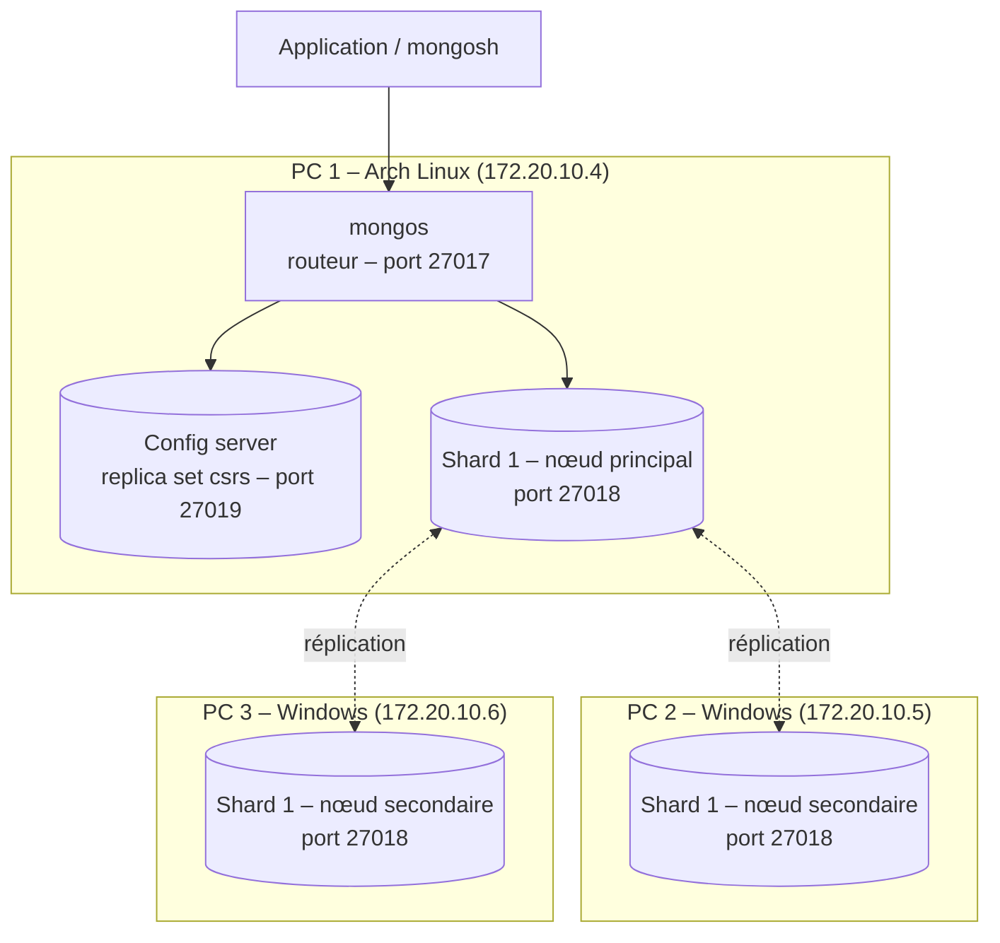

# Cluster MongoDB distribué avec Docker

Cluster MongoDB 7.0 réparti sur **3 machines physiques** reliées au même réseau Wi-Fi, avec **réplication** des données et **basculement automatique (failover)** en cas de panne d'un nœud.

**Technologies :** MongoDB 7.0, Docker, Docker Compose, mongosh, Bash, Linux (Arch) et Windows

## Architecture



| Composant | Rôle |
| --- | --- |
| **mongos** | Routeur : point d'entrée unique, il dirige chaque requête vers le bon shard |
| **Config server** (`csrs`) | Stocke les métadonnées du cluster (répartition des données entre shards) |
| **Shard 1** (`shard1rs`) | Replica set de 3 nœuds sur 3 machines : 1 principal, 2 secondaires |

Si le nœud principal tombe, les secondaires **élisent automatiquement un nouveau principal** et les données restent accessibles.

## Contenu du dépôt

| Fichier | Description |
| --- | --- |
| `demarrer.sh` | Lance le cluster sur le PC 1 et initialise le config server, le shard et le routeur mongos |
| `tester-failover.sh` | Insère des données, arrête le nœud principal, puis vérifie que les données sont toujours disponibles |
| `docker-compose.yml` | Configuration d'un nœud secondaire du shard (PC 2 et PC 3) |
| `SETUP.txt` | Guide complet d'installation pour les 3 machines, avec la configuration Docker du PC 1 |

## Lancer le cluster

**Prérequis :** Docker installé sur les 3 machines, toutes connectées au même réseau.

**1. Sur le PC 1 (Linux)**, créer le `docker-compose.yml` du PC 1 décrit dans `SETUP.txt`, puis :
```bash
chmod +x demarrer.sh tester-failover.sh
./demarrer.sh
```

**2. Sur le PC 2 et le PC 3 (Windows)**, lancer le nœud secondaire :
```bash
docker-compose up -d
```

**3. Sur le PC 1**, ajouter les deux secondaires au replica set :
```javascript
// docker exec -it shard1 mongosh --port 27018
rs.add({ host: "172.20.10.5:27018", priority: 5 })
rs.add({ host: "172.20.10.6:27018", priority: 5 })
rs.status()   // les 3 nœuds doivent apparaître
```

**4. Vérifier le cluster** depuis le routeur :
```javascript
// docker exec -it mongos mongosh
sh.status()
```

## Tester le failover

```bash
./tester-failover.sh
```

Le script :
1. insère des documents dans la base `testdb` via mongos ;
2. arrête le conteneur du nœud principal ;
3. le redémarre après l'élection d'un nouveau principal ;
4. relit les données pour vérifier qu'aucune n'a été perdue.

## Ce que j'ai appris

- Mettre en place une architecture MongoDB distribuée : routeur **mongos**, **config server** et **shard** en replica set.
- Configurer la **réplication** entre plusieurs machines réelles (Linux et Windows) avec Docker.
- Tester la **haute disponibilité** : élection automatique d'un nouveau principal lors d'une panne.
- Diagnostiquer les problèmes réseau entre conteneurs et machines (ports, adresses IP, `bind_ip`).
